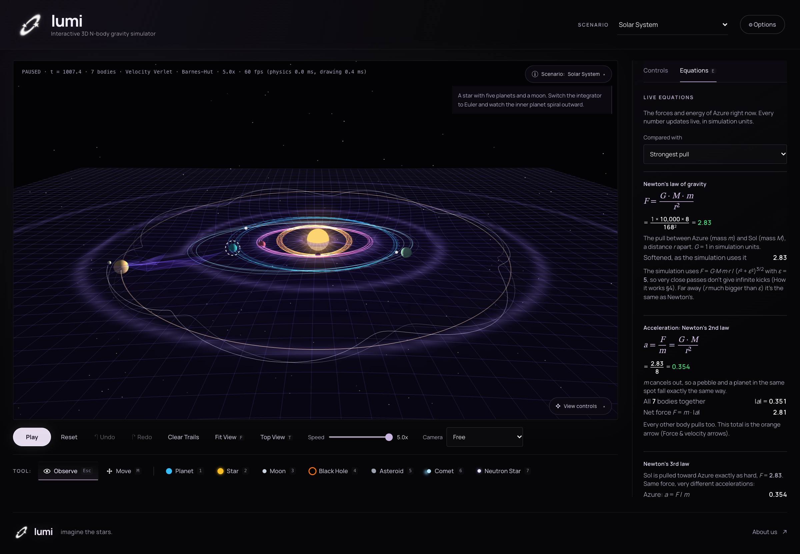
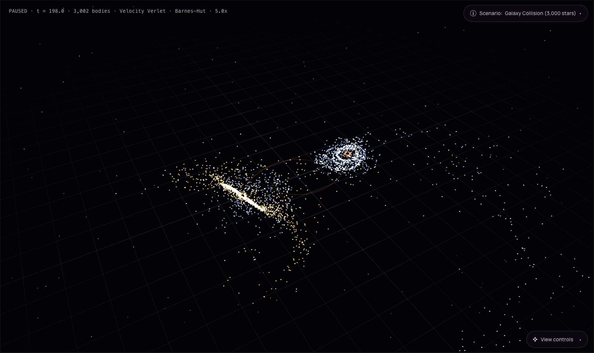

# lumi

*imagine the stars.*

**An approachable, interactive 3D gravity simulator** for planets, stars and black holes. Built to help anyone explore, visualize, and learn a little about astrophysics. Place bodies, throw them into orbit, crash galaxies together, and watch how they pull on each other. Every number on the screen comes from the actual equations, live.

<p align="center">
  
  
</p>

Built for the **SPS MathPhys (2026) Hackathon**, theme: **Visualization of Physical Processes**. Our process: **gravity between many bodies** (the N-body problem).



**▶ Try it in your browser:** https://alexzheng02.github.io/lumi/

## Table of Contents

1. [Running it](#-running-it)
2. [What you can do](#-what-you-can-do)
3. [Scenarios](#-scenarios)
4. [Controls](#-controls)
5. [How it works](#-how-it-works)
6. [How we know it's right](#-how-we-know-its-right)
7. [Project structure](#-project-structure)
8. [Credits](#-credits)
9. [Team](#-team)
10. [Ideas for next steps](#-ideas-for-next-steps)

---

## 🚀 Running it

There's nothing to install or build. It's a web page.

**Option 1: open the file**
1. Download the project: the green **Code → Download ZIP** button on GitHub, then unzip it. Or clone it:
   ```bash
   git clone https://github.com/alexzheng02/lumi.git
   cd lumi
   ```
2. Open `index.html` in a web browser (Chrome, Edge, Firefox or Safari):
   ```bash
   start index.html       # Windows
   open index.html        # macOS
   xdg-open index.html    # Linux
   ```

**Option 2: a local web server** (if your browser blocks local files)
```bash
python3 -m http.server 8000
# then visit http://localhost:8000
```

Keep the `lib/` folder next to `index.html`: it holds Three.js, the 3D drawing library. It's included so the simulator works with no internet connection.

**Needs:** any recent browser with WebGL (practically every computer, tablet and phone from the last 10 years).

---

## ✨ What you can do

- **10 ready-made scenarios** (below), or start from empty space.
- **Place bodies:** planets, stars, moons, black holes, asteroids, comets (their tails point away from the star) and neutron stars (pulsars). Click to snap into an automatic circular orbit: planets prefer stellar hosts, while moons prefer nearby planets. The preview warns when stellar tides may make a moon’s orbit unstable, without preventing placement. Drag to throw with a manual velocity. A new body never changes the existing bodies’ velocities. Adding mass can destabilize the system: collisions, infall, and ejections remain part of the physics. Massive bodies without a suitable host inherit the system’s average motion rather than being launched around a smaller body. A dashed line shows where the new body will go.
- **Edit anything:** mass, size, position and velocity of any body, by typing, with sliders, or by dragging it on the canvas with the Move tool.
- **Equations tab:** select a body to see Newton's laws, energy, momentum, escape speed and Kepler's laws, each with **the simulation's live numbers plugged in**.
- **See gravity itself:**
  - **Contour map:** glow and rings of equal potential
  - **Rubber sheet:** how deep the gravity wells are
  - **Pull sheet:** which way gravity pulls, from above and below
  - **3D gravity field arrows**
  - **Force and velocity arrows** on each body
  - **The predicted Kepler ellipse** for the selected body
- **See the algorithm:** turn on the Barnes-Hut tree to watch the simulator group distant bodies into cubes, and drag the θ slider to trade accuracy for speed.
- **Watch the energy graph:** kinetic, potential and total energy, with a live "energy drift" readout that shows how accurate the simulation is.
- **Undo / redo** any edit, including resetting or switching scenario.
- **⚙ Options:** trails, labels, grid, background stars, a performance readout and more, saved in your browser.

### Auto-pause while editing

By default, the simulation keeps running while you edit, so you can watch changes take effect live. If you drag a body with the Move tool, it's held still under the mouse (still pulling on everything else) and carries on with its old velocity when you let go.

Tick **Auto-pause while editing** in **⚙ Options** to pause instead while you place a body, drag one, move a slider or type in a box. It carries on when you finish, unless you had paused it yourself.



---

## 🌌 Scenarios

| Scenario | What it shows |
|---|---|
| **Solar System** | A star, five planets on slightly tilted orbits, and a moon. Switch to the Euler integrator and watch the inner planet spiral out. |
| **Star & Planet** | The simplest orbit: gravity points at the star, velocity is sideways. |
| **Binary Stars** | Two stars orbiting their shared centre of mass, with planets circling both (like Tatooine). |
| **Figure-8** | Three equal masses on a famous exact solution of the three-body problem (Moore 1993; Chenciner & Montgomery 2000). It's chaotic, so it eventually breaks apart. |
| **Gravity Assist** | A trapped probe steals energy from a giant planet and escapes, the trick that sent Voyager to the outer planets. |
| **Black Hole Disk** | A disk of moons around a black hole, torn apart by a star swooping in from above. |
| **Random Cluster** | Forty planets in a spinning ball collide, merge and settle into orbits. |
| **Planet Formation** | 1,500 rocks orbit a young star and merge into planets. |
| **Galaxy Collision** | Two galaxies of 1,500 stars each. The one spinning the same way it moves throws out long tidal tails; the other barely changes (Toomre & Toomre 1972). |
| **Asteroid Belt & Comet** | A belt of 180 asteroids and a comet on a stretched, tilted orbit: it speeds up near the star (Kepler's 2nd law) and its tails grow. |

---

## 🎮 Controls

| Action | Mouse / touch | Keys |
|---|---|---|
| Rotate the view | Drag (Observe tool) | ← → ↑ ↓ |
| Slide the view | Right-drag, Shift + drag, or two fingers | W A S D |
| Move the view (and the grid) up / down | Pad buttons | Q / Z |
| Zoom | Scroll, or pinch | Pad + / − |
| Select a body | Click it | |
| Move a body | Move tool, then drag (Shift + drag: up/down) | M |
| Place a body | Pick a type, then click (orbit) or drag (throw) | 1 – 7 |
| Back to Observe / cancel | | Esc |
| Play / pause | Play button | Space |
| Undo / redo | Buttons | Ctrl + Z / Ctrl + Shift + Z |
| Fit everything in view | Fit View | F |
| Top view / tilted view | Top View | T |
| Equations tab | | E |
| Reset the scenario | Reset | R |
| Delete the selected body | Delete button | Delete |
| Apply a typed value | | Enter (in a number box) |

The **View controls** panel on the canvas has buttons for all of the view moves, for trackpads and phones.

---

## 🧮 How it works

The full explanation, written for a general audience, is in the app under **How it works** (bottom of the side panel). In short:

1. **Newton's law of gravity.** Every body pulls on every other with F = G·M·m / r². Each pair is visited once and gets equal and opposite pulls (Newton's 3rd law). To stop near-collisions giving infinite kicks, r² becomes r² + ε² (*softening*).
2. **Velocity Verlet integration.** Time moves in small steps: half a kick to the velocity, move, recompute gravity, the other half kick. This method is *symplectic*, so energy errors stay tiny instead of building up. Simple Euler is included to show why that matters.
3. **Barnes-Hut algorithm (Barnes & Hut 1986).** Above 200 bodies, space is split into an **octree** of cubes. A far-away cube pulls almost exactly like one body at its centre of mass, so the work grows like n log n instead of n². That turns 4.5 million pairs into about 900,000 pulls per step for 3,000 stars. Bodies in the same small cube share their list of pulls, and a correction step keeps total momentum exactly constant.
4. **Collisions.** Touching bodies merge. Mass and momentum are conserved exactly; the kinetic energy lost to heat is calculated and allowed for in the energy readout. Collisions are found by *sweep and prune*: bodies are sorted left to right, and each one only checks neighbours that overlap it.
5. **Energy and orbits.** Kinetic and potential energy are measured every frame. For the selected body, the two-body problem gives its orbit's shape, period and escape speed exactly (Kepler's laws).
6. **3D drawing.** [Three.js](https://threejs.org) turns the scene into pixels on the graphics card. All the physics is our own code.

## ✅ How we know it's right

**34 automated checks** compare the simulator with answers worked out independently, and **all pass**. They cover:
- Kepler's laws: matched to 0.003% with softening off
- escape speed
- conservation of energy and momentum
- collisions
- the known figure-8 period: within 0.24%
- Barnes-Hut against the exact method: 0.17% average force error at the default θ

Full results, and the known approximations, are in **[VALIDATION.md](VALIDATION.md)**. To rerun them yourself:

```bash
npm install playwright
npx playwright install chromium
node tests/validate.js
```

---

## 📁 Project structure

```
index.html          The page: layout, panels, scenario list, "How it works"
script.js           Everything else, in 7 sections:
                      1. settings and state
                      2. physics (gravity, octree, time stepping, collisions, energy, orbits)
                      3. scenarios
                      4. camera
                      5. drawing (Three.js)
                      6. controls (tools, panels, Equations tab, undo, options)
                      7. the main loop
style.css           Look and layout (works on phones too)
lib/                Three.js r149 and its MIT licence
tests/validate.js   The physics checks
VALIDATION.md       What the checks found
docs/               Screenshots for this page
```

All values are in **simulation units** with G = 1, chosen so numbers stay readable. Real systems would just scale these units.

---

## 🙏 Credits

- **3D drawing:** [Three.js](https://threejs.org) r149, MIT licence (`lib/three-LICENSE.txt`).
- **Physics and algorithms:**
  - J. Barnes & P. Hut, *A hierarchical O(N log N) force-calculation algorithm*, Nature 324 (1986)
  - A. Toomre & J. Toomre, *Galactic bridges and tails*, ApJ 178 (1972)
  - C. Moore, *Braids in classical dynamics*, Phys. Rev. Lett. 70 (1993)
  - A. Chenciner & R. Montgomery, *A remarkable periodic solution of the three-body problem*, Annals of Math. 152 (2000)
  - J. Wisdom, *The resonance overlap criterion and the onset of stochastic behavior in the restricted three-body problem*, AJ 85 (1980)
- **AI use:** written with help from Claude (Anthropic's AI assistant), as allowed and required to be credited by the hackathon rules.

## 👥 Team

- Alex Zheng
- Dewa Amandara

Special thanks to **SIAM Student Chapter, Stony Brook**.

Meet the team and read our story on the [About us page](https://alexzheng02.github.io/lumi/about.html).

## 💡 Ideas for next steps

- ~~**Formula display tab**: equations like F = ma, a = GM/r², KE = ½mv² with live values~~ ✅ done: the **Equations** tab
- **Real units**: show distances in AU, masses in Suns and times in years, alongside simulation units
- **Save and share**: save a system you built to a file or a link, and load it again later
- **Run physics in the background** (a Web Worker), so huge systems never slow down the controls
- **General relativity correction**: add the small extra pull that makes Mercury's orbit slowly rotate
